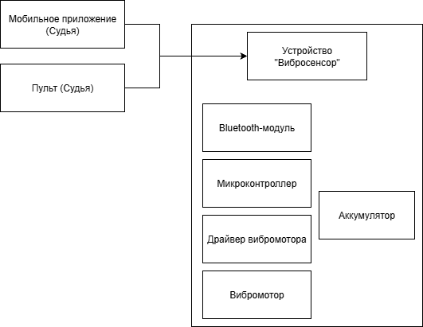

# VibroSensor

Мобильное приложение для управления виброустройством для слабослышащих спортсменов. Проект команды для «Студенческой весны 2026».

Во время боя судья подаёт команды (старт, стоп, пауза) с телефона. Устройство на спортсмене передаёт их вибрацией, поэтому звуковой сигнал не нужен.

## Как это работает

```
Android-приложение (судья)  --WebSocket (JSON)-->  Raspberry Pi  -->  вибромодули на спортсменах
```

- Приложение подключается к серверу на Raspberry Pi по адресу `ws://<ip>:<port>`. IP и порт задаются в настройках.
- Команды отправляются как JSON, например `{"command": "VIBRATE_SHORT"}`.
- Поддерживаются короткая и длинная вибрация, непрерывная вибрация (пока кнопка удерживается) и запрос числа подключённых устройств.
- Есть экспериментальный Bluetooth-клиент (SPP) для прямого подключения к Raspberry Pi.

Схема устройства:



## Структура

| Путь | Что внутри |
|---|---|
| `app/src/main/java/.../network/WebSocketClient.kt` | WebSocket-клиент на OkHttp |
| `app/src/main/java/.../network/BluetoothClient.kt` | Bluetooth-клиент (SPP) |
| `app/src/main/java/.../ui/match/MatchFragment.kt` | Экран боя: кнопки команд, статус подключения |
| `app/src/main/java/.../ui/settings/SettingsFragment.kt` | Настройки: IP и порт сервера, вибрация телефона, тёмная тема |
| `app/src/main/java/.../data/Athlete.kt` | Модели: спортсмен, состояние матча, типы команд |

## Стек

Kotlin, Android SDK (minSdk 24, targetSdk 36), OkHttp 4 (WebSocket), Material Components, Navigation.

## Запуск

1. Откройте проект в Android Studio и дождитесь синхронизации Gradle.
2. Запустите приложение на телефоне, подключённом к той же сети, что и Raspberry Pi.
3. В настройках укажите IP-адрес Raspberry Pi и порт, нажмите «Сохранить настройки», затем «Подкл.» на экране боя.

Короткая вибрация означает СТАРТ, длинная СТОП. Кнопку «Вибрация» нужно удерживать, пока вибрация нужна.

Серверная часть на Raspberry Pi в этот репозиторий не входит.
